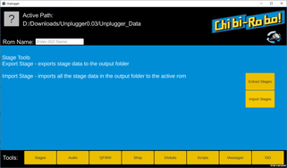

# :electric_plug: Unplug - Chibi-Robo! Modding Toolkit


[](https://github.com/adierking/unplug/releases)
[](https://github.com/adierking/unplug/actions)
[](https://coveralls.io/github/adierking/unplug)
[](COPYING)

:satellite: [Download](https://github.com/adierking/unplug/releases)  
:books: [Documentation](#documentation)  
:star: [Goals](#goals)  
:robot: [Features](#features)  
:thinking: [How to Use](#how-to-use)  
:gear: [Compiling](#compiling)  
:wrench: [Contributing](#contributing)  

## Download

Go to the [releases page](https://github.com/adierking/unplug/releases) to download a prebuilt
binary for Windows, macOS, or Linux.

You can also get bleeding-edge continuous builds
[here](https://github.com/adierking/unplug/actions), though these are undocumented and not
guaranteed to work correctly.

### Unplugger

If command-line tools aren't your thing and you want to use Unplug through a GUI, check out
emistro's [Unplugger](https://emistro.itch.io/unplugger)!

(Note that this packages its own Unplug build which may be different from the latest release.)



## Documentation

- **[Tour Guide (Start Here!)](docs/tour.md)**
- **[Scripting Reference](docs/scripting.md)**
- **[Scripting Tips 'n Tricks](docs/scripting-tips.md)**

## Goals

- **Modding**: Build a foundation for editing game assets
- **Reverse Engineering**: Help the community learn more about how the game works
- **Self-Contained**: Unplug should be the only tool you need to mod the game
- **Correctness**: What you see is what the game sees

## Features

- Built-in support for ISO reading and writing
- Audio export, import, and playback
- Edit objects in stage files
- Edit script bytecode
- Edit the global metadata
- Edit the shop
- Edit cutscene messages

Stay tuned for more!

## How to Use

You will need an NTSC-U (GGTE01) *Chibi-Robo! Plug Into Adventure!* ISO to use Unplug. Other
versions of the game are not currently supported due to the amount of effort that would be required.

Unplug is a command-line app, so you'll need to open PowerShell/Command Prompt/Terminal to use
it. On Windows 10+, you should try downloading Windows Terminal from the Store.

Each function provided by Unplug is a subcommand of the main program. Running Unplug without any
command-line arguments or with `help` will display a list of available commands.

Follow the [tour guide](docs/tour.md) for examples of how to use each command.

## Compiling

Prerequisites:

- Rust 1.88+
- C compiler (for dependencies)
- CMake (for dependencies)
- [Just](https://just.systems/) (optional, for development shortcuts)

To make a debug build, you can compile with Cargo as usual:

```sh
cargo build
cargo run -- arg...
```

To make a distribution build (nightly toolchain required):

```sh
just dist
```

To build and run the unit tests:

```sh
cargo test --lib
```

To run the full test suite, you will need to point the `CHIBI_ISO` environment variable to a
GGTE01 ISO. In PowerShell, you can do that like this:

```powershell
$Env:CHIBI_ISO="C:\path\to\the.iso"
cargo test
```

Alternatively, create a `.env` file with `CHIBI_ISO` set to the ISO path and run `just test-iso`.

The tests will not modify the ISO, but some will copy it to your temporary directory - this means
you will need 1.4 GB of free space.

## Contributing

Unplug is currently licensed under the MIT license.

There are lots of ways you can contribute to the project:

- Submit issue reports
- Open pull requests to fix bugs or add new features
- Help map out unknown structs/opcodes
- Build higher-level tools (e.g. GUIs) on top of Unplug
- Make and share cool mods!

No AI-generated code, documentation, issues, or comments will be accepted. Using AI for
reverse-engineering is allowed provided that you disclose it and can demonstrate that you understand
the results in your own words.
